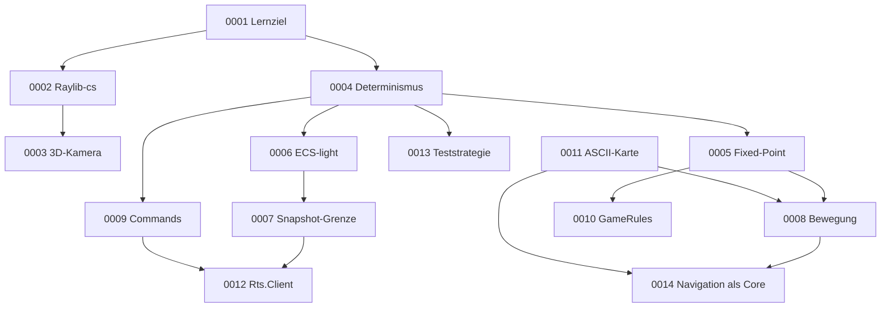

# Architecture Decision Records

Entscheidungen der RTS-Engine (AoE-Clone). Format: MADR (voll) bzw. Lightweight ADR. Nummern werden nie wiederverwendet, und abgelöste ADRs werden nicht gelöscht, sondern auf `Superseded` gesetzt.

| ID                                                        | Title                                                                  | Status   | Date       | Deciders     |
| --------------------------------------------------------- | ---------------------------------------------------------------------- | -------- | ---------- | ------------ |
| [ADR-0001](0001-learning-goal-engine-on-demand.md)        | Lernziel Engine-Technik, Features nur auf Bedarf                       | Accepted | 2026-10-19 | Jonas Gerber |
| [ADR-0002](0002-desktop-only-with-raylib-cs.md)           | Desktop-only mit Raylib-cs                                             | Accepted | 2026-10-19 | Jonas Gerber |
| [ADR-0003](0003-3d-fixed-camera-2d-simulation.md)         | 3D mit fester Schrägkamera, Simulation bleibt 2D                       | Accepted | 2026-10-19 | Jonas Gerber |
| [ADR-0004](0004-deterministic-fixed-tick-simulation.md)   | Deterministische Simulation mit festem Tick und Command-Queue          | Accepted | 2026-10-19 | Jonas Gerber |
| [ADR-0005](0005-fixed-point-q48-16.md)                    | Eigener Fixed-Point-Typ Q48.16 auf `long`                              | Accepted | 2026-10-19 | Jonas Gerber |
| [ADR-0006](0006-ecs-light-with-mutable-sim-state.md)      | ECS-light mit Ausnahme für mutable Simulationsdaten                    | Accepted | 2026-10-19 | Jonas Gerber |
| [ADR-0007](0007-snapshot-boundary-with-interpolation.md)  | Snapshot-Grenze zwischen Simulation und Rendering mit Interpolation    | Accepted | 2026-10-19 | Jonas Gerber |
| [ADR-0008](0008-continuous-movement-grid-pathfinding.md)  | Kontinuierliche Bewegung, Grid nur für Pfadsuche                       | Accepted | 2026-10-19 | Jonas Gerber |
| [ADR-0009](0009-typed-commands-with-sim-validation.md)    | Typisierte Commands, Auflösung im Client, Validierung in der Simulation | Accepted | 2026-10-19 | Jonas Gerber |
| [ADR-0010](0010-game-rules-injected-record.md)            | Spielwerte als injizierter `GameRules`-Record                          | Accepted | 2026-10-19 | Jonas Gerber |
| [ADR-0011](0011-ascii-map-format.md)                      | ASCII-Kartenformat mit Validierung                                     | Accepted | 2026-10-19 | Jonas Gerber |
| [ADR-0012](0012-client-module.md)                         | Modul `Rts.Client` für Kamera, Auswahl und Input                       | Accepted | 2026-10-19 | Jonas Gerber |
| [ADR-0013](0013-test-strategy-os-matrix-golden-hash.md)   | Teststrategie mit OS-Matrix, Golden-Hash und Coverage-Ausnahme         | Accepted | 2026-10-19 | Jonas Gerber |
| [ADR-0014](0014-navigation-as-core-library.md)           | Navigation als Core-Bibliothek statt Feature-Modul                     | Accepted | 2026-10-19 | Jonas Gerber |

## Abhängigkeiten

## Action Items nach Schritt

Die Schritte beziehen sich auf die Umsetzungsreihenfolge von Meilenstein 1 (Schritt 0 = BFS abschliessen … Schritt 10 = Produktion).

| Schritt | ADR-Action-Items                                              |
| ------- | ------------------------------------------------------------- |
| 1       | 0005 #1–2, 0013 #1                                            |
| 2       | 0013 #2                                                       |
| 3       | 0005 #3                                                       |
| 4       | 0004 #1–3, 0006 #1–3, 0007 #1                                 |
| 6       | 0013 #3                                                       |
| 7       | 0002 #1–3, 0007 #2–3, 0013 #4–5                               |
