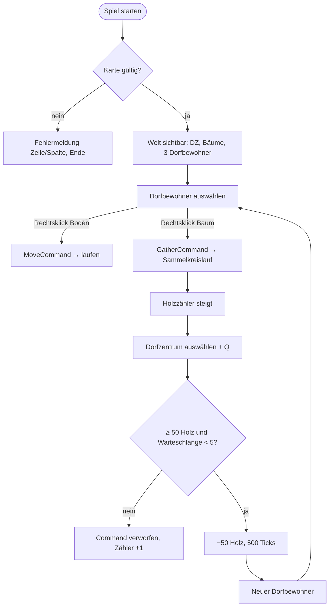
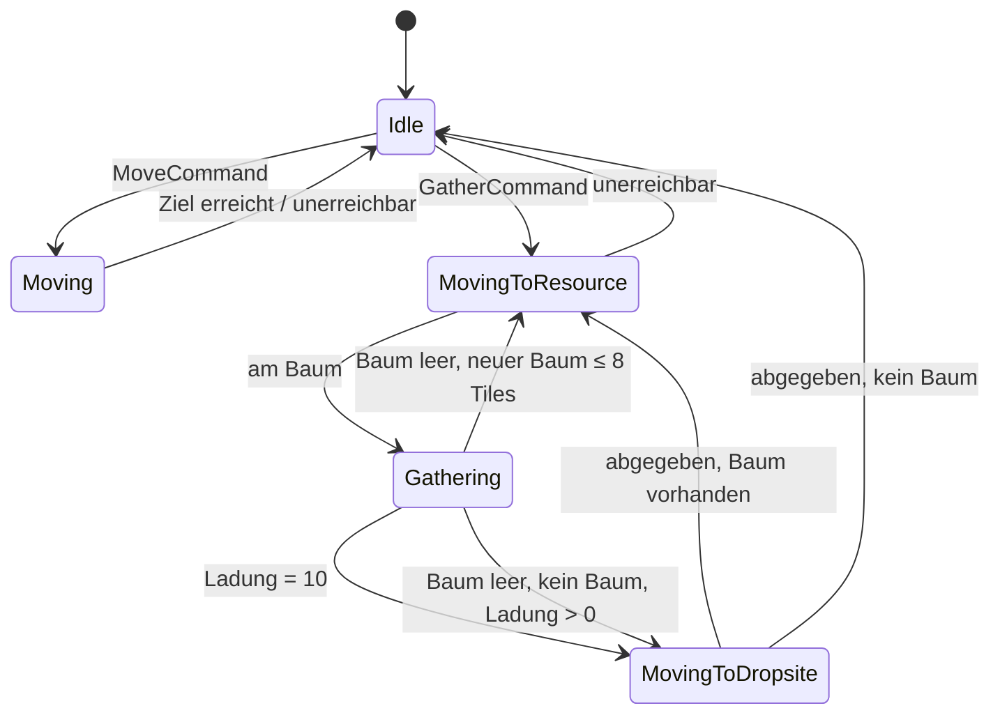

# PRD: Meilenstein 1, Wirtschaftskreislauf

## 1. Header

| Field              | Value                                                 |
| ------------------ | ----------------------------------------------------- |
| **Document**       | PRD: Meilenstein 1, Wirtschaftskreislauf              |
| **Author**         | AI-generated, reviewed by Jonas Gerber                |
| **Status**         | Approved                                              |
| **Created**        | 2026-10-19                                            |
| **Last Updated**   | 2026-10-19                                            |
| **Stakeholders**   | Jonas Gerber (Entwickler, Spieler, Entscheider)       |
| **Target Release** | Meilenstein 1, abgeschlossen mit Schritt 10 (keine Deadline) |

## 2. Problem Statement & Context

| Element | Inhalt |
| ------- | ------ |
| Problem | Die Engine hat Module (Navigation, Simulation, Rendering, Jobs, Primitives), aber kein Gameplay, das sie antreibt. Bis auf `NavGrid` und BFS sind alle Module Platzhalter (`Class1.cs`). Ohne ein konkretes Spielziel kann die Regel „Engine-Features nur auf Bedarf“ ([ADR-0001](decisions/0001-learning-goal-engine-on-demand.md)) nicht greifen, und es bleibt offen, wann ein Engine-Feature fertig ist. |
| Context | Lernprojekt zur RTS-Engine-Technik. Die Architektur ist in ADR-0001 bis ADR-0013 festgelegt. Referenzverhalten ist der Wirtschaftskern von Age of Empires II. |
| Impact  | Ohne diesen Meilenstein entsteht Infrastruktur auf Vorrat. Determinismus und die Snapshot-Grenze bleiben unbewiesen, bis spätere Features darauf aufbauen. |

## 3. Goals & Success Criteria

| # | Ziel | KPI | Baseline → Target | Messung |
| - | ---- | --- | ----------------- | ------- |
| G1 | Kreislauf ist spielbar | Spieltest: 2 neue Dorfbewohner aus 0 Holz, ohne Debug-Eingriff | nicht möglich → < 3 min Spielzeit | manuelle Checkliste |
| G2 | Verhalten ist spezifiziert und abgesichert | Must-Szenarien als automatisierte Tests | 0 % → 100 % (US-01 bis US-03 visuell geprüft) | CI |
| G3 | Plattformübergreifender Determinismus | Golden-Hash im Headless-Szenario | nicht vorhanden → identisch auf Win/Linux/macOS | CI-Matrix ([ADR-0013](decisions/0013-test-strategy-os-matrix-golden-hash.md)) |
| G4 | Logik ist getestet | Line Coverage der Logikmodule | unbekannt → ≥ 80 % | coverlet |
| G5 | Laufruhe | FPS / Tick-Dauer bei 50 Entities | — → ≥ 60 FPS, Tick < 1 ms | Debug-Overlay auf dem Entwicklungsrechner |

Messfenster: bei Abschluss von Schritt 10.

**Non-goals:** Balancing-Qualität, optische Qualität (Primitive genügen), Spielspass über den Kreislauf hinaus, Performance über 50 Entities hinaus, Gegner bzw. KI.

## 4. User Stories & Acceptance Criteria

Persona: **Spieler/Entwickler** (eine Person, Maus + Tastatur, Desktop).

#### US-01: Spiel starten und Karte sehen

**As a** Spieler, **I want** beim Start die Karte sehen **so that** ich weiss, wo Ressourcen liegen. **Priority:** Must

- **Scenario 1:** Gültige Karte
  - Given eine gültige ASCII-Karte mit `C`-Block, `T` und 3× `V`
  - When das Spiel startet
  - Then sind Dorfzentrum (Würfel), Bäume (Kegel) und 3 Dorfbewohner (Zylinder) an den Kartenpositionen sichtbar
  - And das HUD zeigt Holz 0 und Dorfbewohner 3

#### US-02: Kamera bewegen und zoomen

**As a** Spieler, **I want** die Kamera bewegen **so that** ich die ganze Karte erreiche. **Priority:** Must

- **Scenario 1:** Verschieben
  - Given das laufende Spiel
  - When ich W/A/S/D oder die Pfeiltasten halte
  - Then bewegt sich die Kamera in diese Richtung
- **Scenario 2:** Grenzen
  - Given die Kamera steht am Kartenrand
  - When ich weiter nach aussen verschiebe bzw. über das Limit zoome
  - Then bleibt die Kamera an der Grenze stehen

#### US-03: Einheiten auswählen

**As a** Spieler, **I want** Einheiten per Klick oder Rahmen auswählen **so that** ich ihnen Befehle geben kann. **Priority:** Must

- **Scenario 1:** Einzelklick: When ich auf einen Dorfbewohner linksklicke, Then ist nur er ausgewählt (Auswahlring)
- **Scenario 2:** Rahmen: Given 3 Dorfbewohner, When ich einen Rahmen um 2 ziehe, Then sind genau diese 2 ausgewählt
- **Scenario 3:** Abwählen: When ich auf leeren Boden linksklicke, Then ist nichts ausgewählt
- **Scenario 4:** Dorfzentrum: When ich auf das Dorfzentrum klicke, Then ist es ausgewählt, und das HUD zeigt die Warteschlange

#### US-04: Einheiten bewegen

**As a** Spieler, **I want** Einheiten per Rechtsklick bewegen **so that** ich sie positionieren kann. **Priority:** Must

- **Scenario 1:** Given 2 ausgewählte Dorfbewohner, When Rechtsklick auf ein freies Tile, Then entsteht ein `MoveCommand`, und beide laufen per BFS-Pfad dorthin und bleiben stehen
- **Scenario 2:** Given ein Ziel hinter `#`-Hindernissen, Then führt der Pfad um die Hindernisse herum
- **Scenario 3:** Given ein unerreichbares Ziel, Then bleiben die Einheiten `Idle` (kein Absturz)

#### US-05: Holz sammeln

**As a** Spieler, **I want** Dorfbewohner auf Bäume schicken **so that** sie selbstständig Holz liefern. **Priority:** Must

- **Scenario 1:** Kreislauf
  - Given ein ausgewählter Dorfbewohner mit leerer Ladung
  - When ich auf einen Baum rechtsklicke
  - Then läuft er zu einem freien Nachbar-Tile des Baums und sammelt 1 Holz pro 50 Ticks
  - And bei 10 Holz läuft er zum Dorfzentrum, und der Holzzähler steigt um 10
  - And er kehrt danach zum selben Baum zurück
- **Scenario 2:** Mehrere Sammler: Given 3 Dorfbewohner am selben Baum, Then sammeln alle parallel

#### US-06: Grenzfälle des Sammelns

**As a** Spieler, **I want** dass Sammler in Grenzfällen sinnvoll weitermachen **so that** ich sie nicht dauernd betreuen muss. **Priority:** Must

Jede Zeile in [Abschnitt 7](#7-edge-cases--error-states) (E1–E8) ist ein eigenes Szenario und ein eigener Integrationstest.

#### US-07: Dorfbewohner produzieren

**As a** Spieler, **I want** im Dorfzentrum Dorfbewohner produzieren **so that** meine Wirtschaft wächst. **Priority:** Must

- **Scenario 1:** Given das Dorfzentrum ist ausgewählt und ich habe ≥ 50 Holz, When ich Q drücke, Then werden 50 Holz abgezogen, und ein Eintrag erscheint in der Warteschlange
- **Scenario 2:** Given ein Eintrag in Produktion, When 500 Ticks vergangen sind, Then erscheint ein Dorfbewohner auf dem ersten freien Tile um das Dorfzentrum
- **Scenario 3:** Given 3 Einträge, Then werden sie nacheinander produziert, und der Fortschrittsbalken zeigt den aktuellen Eintrag

#### US-08: Ungültige Produktion

**As a** Spieler, **I want** dass ungültige Befehle nichts kaputtmachen **so that** das Spiel stabil bleibt. **Priority:** Must

- **Scenario 1:** Given < 50 Holz, When Q, Then ändert sich nichts, und der Zähler für verworfene Commands (Grund `InsufficientResources`) steigt um 1
- **Scenario 2:** Given 5 Einträge in der Warteschlange, When Q, Then wird der Befehl verworfen (Grund `QueueFull`), und es wird kein Holz abgezogen

#### US-09: Debug-Overlay

**As a** Entwickler, **I want** ein Debug-Overlay **so that** ich das Innenleben der Engine sehe. **Priority:** Should

- **Scenario 1:** When F3, Then werden Grid-Linien, blockierte Tiles, aktuelle Pfade, der Zustand pro Einheit, die Tick-Nummer, FPS/TPS, der State-Hash und die Zähler verworfener Commands angezeigt
- **Scenario 2:** When erneut F3, Then ist das Overlay aus

#### US-10: Deterministisches Headless-Szenario

**As a** Entwickler, **I want** Szenarien headless abspielen **so that** Determinismus und Verhalten automatisch geprüft werden. **Priority:** Must

- **Scenario 1:** Given Karte + Command-Skript, When `Rts.Headless` es zweimal ausführt, Then sind beide End-Hashes identisch
- **Scenario 2:** Given dasselbe Szenario auf Windows, Linux und macOS, Then entspricht der End-Hash überall dem eingecheckten Golden-Hash

#### US-11: Kartenvalidierung

**As a** Entwickler, **I want** klare Fehler bei ungültigen Karten **so that** ich Testkarten schnell korrigiere. **Priority:** Must

- **Scenario 1:** Given ein unbekanntes Zeichen in Zeile 3, Spalte 7, Then lautet die Fehlermeldung sinngemäss „Unbekanntes Zeichen 'X' in Zeile 3, Spalte 7“, und es gibt keinen Start
- **Scenario 2:** Weitere Fälle: Given nicht rechteckige Zeilen, ein unvollständiger 3×3-`C`-Block, kein `C` oder eine leere Eingabe, Then jeweils eine spezifische Fehlermeldung

## 5. Scope Definition

| In Scope | Out of Scope (Grund, Zeitpunkt) |
| -------- | ------------------------------- |
| Holz als einzige Ressource | Nahrung/Gold/Stein: kein neues Engine-Feature, folgt mit Wirtschaftsausbau |
| Vorplatziertes Dorfzentrum | Gebäudebau: braucht Pfad-Invalidierung (ADR-0008), Meilenstein 2+ |
| BFS mit 4 Nachbarn, Überlappung erlaubt | A\*, Kollision, Formationen: auf Bedarf (ADR-0008) |
| Klick- und Rahmenauswahl, Q-Hotkey, HUD, Debug-Overlay | Shift-Auswahl, Kontrollgruppen, Minimap, Rally Point, Abbrechen: Komfort, später |
| `DefaultRules` in C# | JSON-Loader: auf Bedarf (ADR-0010) |
| Ein Spieler mit `PlayerId` | Gegner, KI, Netzwerk: eigene Meilensteine (ADR-0004) |
| 3D-Primitive, feste Kamera | Modelle, Animationen, Sound, Drehen der Kamera (ADR-0003) |
| Desktop Win/Linux/macOS | Web, Mobile (ADR-0002) |

**Assumptions**

| Annahme | Risiko wenn falsch | Validierung |
| ------- | ------------------ | ----------- |
| Raylib-cs läuft mit .NET 10 auf allen drei OS | Rendering blockiert | Spike vor Schritt 7 |
| Q48.16 ist deterministisch auf x64 und ARM64 | Desync, ADR-0005 neu bewerten | Golden-Hash in der CI (Schritt 6) |
| 50 Entities brauchen keine Optimierung | G5 verfehlt | Messung im Debug-Overlay |
| Tiles werden in Meilenstein 1 nur frei, nie neu blockiert | Ungültige Pfade | Test hält die Annahme fest (ADR-0008) |

**Dependencies:** Raylib-cs (NuGet, Community-Binding), GitHub Actions inkl. macOS-Runner (Minutenkontingent bei privatem Repo).

## 6. User Flow

**Zustandsautomat Dorfbewohner**

Jeder neue Command unterbricht jeden Zustand sofort (E5).

## 7. Edge Cases & Error States

| # | Scenario | Expected Behavior | Severity |
| - | -------- | ----------------- | -------- |
| E1 | Baum wird leer, während gesammelt wird | Baum-Entity entfernt, Tile begehbar; der Sammler sucht den nächsten Baum ≤ 8 Tiles (Pfadlänge). Wird keiner gefunden: Ladung > 0 → abgeben, danach `Idle` | High |
| E2 | Zwei Sammler holen im selben Tick das letzte Holz | Verarbeitung nach aufsteigender `EntityId`: Der erste bekommt es, der zweite verhält sich wie in E1 | High |
| E3 | Mehrere Sammler am selben Baum | Erlaubt, kein Limit, Überlappung ok | Low |
| E4 | Ziel unerreichbar (Baum oder Boden) | BFS findet keinen Weg → `Idle`, keine Exception | Medium |
| E5 | Neuer Command mitten im Sammeln | Neuer Command gewinnt sofort, die getragene Ladung bleibt und wird bei der nächsten Abgabe gutgeschrieben | Medium |
| E6 | Mehrere Abgaben im selben Tick | In aufsteigender `EntityId`-Reihenfolge | High (Determinismus) |
| E7 | Spawn-Tiles um das Dorfzentrum alle blockiert | Produktion wartet bei 100 % und spawnt, sobald ein Tile frei ist; Suche im Uhrzeigersinn ab unten links | Low |
| E8 | Laufender Pfad führt über ein Tile, das frei wird | Pfad bleibt gültig, keine Invalidierung | Low |
| E9 | `Train` ohne genug Holz / volle Warteschlange | Verworfen mit Grund-Zähler, kein Holzabzug (US-08) | Medium |
| E10 | Command mit veralteter `EntityId` (Generation passt nicht) | Verworfen, Grund `StaleEntity` | High (später Netzwerk) |
| E11 | Command für eine fremde Einheit (`Issuer` ≠ Owner) | Verworfen, Grund `NotOwner` | High (später Cheating) |
| E12 | Rechtsklick ohne Auswahl, oder mit Dorfzentrum als einziger Auswahl | Kein Command | Low |
| E13 | Frame-Spike (z. B. Fenster verschoben, 2 s Hänger) | Höchstens `MAX_TICKS_PER_FRAME` Ticks pro Frame, der Rest wird nachgeholt; der Determinismus bleibt unberührt | Medium |
| E14 | Ungültige Karte | Spezifische Fehlermeldung mit Zeile/Spalte, kein Start (US-11) | Medium |
| E15 | Rahmen mit Breite oder Höhe 0 | Wird als Einzelklick behandelt | Low |

Keyboard: Alle Aktionen ausser Auswahl und Rechtsklick sind per Taste erreichbar (WASD, Q, F3). Weitergehende Accessibility ist nicht Teil von Meilenstein 1.

## 8. Technical Considerations

| Area | Consideration |
| ---- | ------------- |
| Architecture | Vollständig durch ADR-0001 bis ADR-0013 festgelegt ([Index](decisions/README.md)). Kernpunkte: deterministischer Tick mit 20/s, Q48.16, ECS-light, `WorldSnapshot`-Grenze, neues Modul `Rts.Client`. |
| Data | `GameRules`/`DefaultRules` (Anhang A), `MapDefinition` aus dem ASCII-Parser, Szenario-Format für Headless (Karte + Commands mit Tick-Stempel) |
| APIs | Öffentliche Verträge in `*.Contracts`: Commands, `WorldSnapshot`, `EntityId`, `PlayerId`. Änderungen daran sind Breaking für Headless-Szenarien und den Golden-Hash. |
| Performance | Ziel ≥ 60 FPS und Tick < 1 ms bei 50 Entities; Snapshot-Allokation pro Tick ist akzeptiert (ADR-0007) |
| Security | Parser und Command-Validierung sind Systemgrenzen (ADR-0009, ADR-0011). Kein Netzwerk in Meilenstein 1. |
| Monitoring | Debug-Overlay: Tick, TPS/FPS, State-Hash, Zähler verworfener Commands je Grund |

**Offene technische Risiken:** Raylib-cs + .NET 10 (Spike), Kosten der macOS-Runner, `Sqrt`-Genauigkeit von Q48.16 bei der Normalisierung kleiner Vektoren.

## 9. Launch Plan

| Phase | Description |
| ----- | ----------- |
| **Rollout strategy** | Ein PR pro Schritt (Anhang B) auf `main`, nach Git-Konvention |
| **Feature flags** | Keine: Einzelentwickler, kein Produktivbetrieb; ein unfertiger Schritt wird nicht gemergt |
| **Rollback plan** | **Trigger:** Golden-Hash-Abweichung oder rote CI auf einem OS → kein Merge. Bei einer Regression auf `main`: Revert-Commit. Ein bewusst geänderter Golden-Hash muss im Commit begründet werden. |
| **Communication** | CHANGELOG-Eintrag pro abgeschlossenem Schritt |
| **Documentation** | README: Build/Start, Steuerung, Headless-Aufruf; Determinismus-Checkliste (ADR-0004) |
| **Training** | — |

## 10. Open Questions

| # | Question | Owner | Due | Status |
| - | -------- | ----- | --- | ------ |
| 1 | Rechtsklick aufs Dorfzentrum mit Ladung: sofort abgeben (wie in AoE) oder nur hinlaufen? Vorschlag: sofort abgeben, als `GatherCommand`-Variante bzw. `DropOffCommand` | Jonas Gerber | Schritt 9 | Open |
| 2 | Wert für `MAX_TICKS_PER_FRAME` (Vorschlag 5) | Jonas Gerber | Schritt 7 | Open |
| 3 | macOS-Runner bei jedem Push oder nur auf PRs/`main`? | Jonas Gerber | Schritt 2 | Open |
| 4 | Szenario-Format für Headless: Textdatei oder C#-Testcode? | Jonas Gerber | Schritt 6 | Open |
| 5 | Referenzrechner für die Messung von G5 | Jonas Gerber | Schritt 7 | Open |

## Anhang A: DefaultRules

| Wert | Pro Sekunde / absolut | Pro Tick (20 Ticks/s) |
| ---- | --------------------- | --------------------- |
| Laufgeschwindigkeit Dorfbewohner | 0,8 Tiles/s | 0,04 Tiles/Tick |
| Tragkapazität | 10 Holz | — |
| Sammelrate | 0,4 Holz/s | 1 Holz alle 50 Ticks |
| Holz pro Baum | 100 | — |
| Kosten Dorfbewohner | 50 Holz | — |
| Produktionszeit | 25 s | 500 Ticks |
| Warteschlange max. | 5 | — |
| Suchradius nächster Baum | 8 Tiles (Pfadlänge) | — |
| Startressourcen | 0 Holz, 3 Dorfbewohner | — |

## Anhang B: Umsetzungsschritte

| # | Schritt | Nachweis | Stories | ADR-Items |
| - | ------- | -------- | ------- | --------- |
| 0 | BFS abschliessen + Nachbar-Ziel | BFS-Tests grün | US-04 (Teil) | — |
| 1 | `Fixed` / `FixedVector2` (TDD), Testprojekte umbenennen | Unit-Tests | — | 0005 #1–2, 0013 #1 |
| 2 | CI-Matrix Win/Linux/macOS | grüne Pipeline auf 3 OS | — | 0013 #2 |
| 3 | ASCII-Parser + Validierung → `NavGrid` | Parser-Tests | US-11 | 0005 #3 |
| 4 | Simulationskern: `EntityId`, Speicher, Tick, Commands, Snapshot, Hash | „leere Welt“ deterministisch | US-10 (Teil) | 0004, 0006, 0007 #1 |
| 5 | `Move` + Bewegungssystem | Integrationstest | US-04 | — |
| 6 | Headless-Runner + Golden-Hash in der CI | gleicher Hash auf 3 OS | US-10 | 0013 #3 |
| 7 | Raylib-Fenster, Kamera, Snapshot-Rendering, Debug-Overlay | sichtbar, flüssig | US-01, US-02, US-09 | 0002, 0007 #2–3, 0013 #4–5 |
| 8 | `Rts.Client`: Picking, Auswahl, Rechtsklick → `Move` | erstmals spielbar | US-03, US-04 | — |
| 9 | Sammelkreislauf inkl. E1–E8 | Integrationstests | US-05, US-06 | — |
| 10 | Produktion, Warteschlange, Spawn, HUD | **Meilenstein 1 erreicht** (G1–G5) | US-07, US-08 | — |
